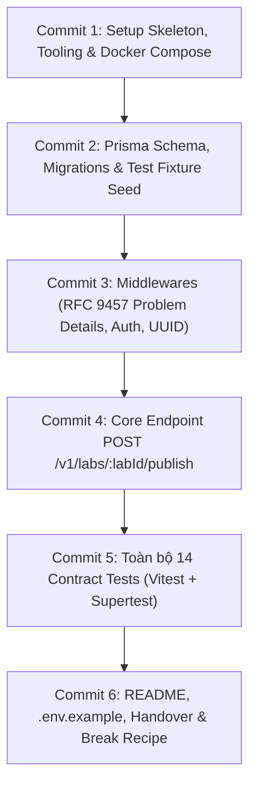

# Lộ trình Phát triển Backend & Kiểm thử (ROADMAP.md) — Dành cho N2
**Dự án**: LeeTKOB · Mốc PA#2 (Harness and Quality Gate)  
**Tài liệu tham chiếu**: `docs/contract/publish.md` và `docs/contract/publish-test-cases.md`  
**Mục tiêu của N2**: Xây dựng trọn vẹn backend tối thiểu chạy được bằng Node.js + Express + TypeScript + Prisma + PostgreSQL, kèm bộ 14 Contract Tests (Vitest + Supertest) xanh 100%, sẵn sàng bàn giao cho N1 làm CI.

---

## 🎯 Tổng quan Kiến trúc & Công nghệ (Tech Stack)
- **Runtime & Language**: Node.js (LTS v20+) + TypeScript
- **Framework Web**: Express.js (tách riêng `app.ts` và `server.ts` để Supertest test trực tiếp không cần mở port)
- **Database & ORM**: PostgreSQL 16 + Prisma ORM (quản lý schema, migration, seed)
- **Môi trường DB**: Docker Compose (`compose.yaml`)
- **Testing**: Vitest + Supertest (chạy non-interactive `vitest run`, exit code chuẩn)
- **Validation & Serialization**: RFC 9457 Problem Details (`application/problem+json`), UUID v4 regex validation

---

## 📋 Thứ tự các Commit & Nội dung chi tiết

---

### 🔹 Commit 1: Khởi tạo Project Skeleton, Cấu hình Tooling & Docker PostgreSQL
**Mục tiêu**: Dựng khung ứng dụng Express + TypeScript, tách app để test và cấu hình Docker PostgreSQL.

- **Các file cần tạo**:
  - `package.json`: Khai báo scripts (`dev`, `build`, `start`, `test`, `typecheck`), dependencies (`express`, `dotenv`, `@prisma/client`) và devDependencies (`typescript`, `@types/express`, `@types/node`, `tsx`, `vitest`, `supertest`, `@types/supertest`, `prisma`).
  - `tsconfig.json`: Cấu hình strict type checking (`strict: true`, `target: ES2022`, `moduleResolution: node`).
  - `compose.yaml`: Dịch vụ PostgreSQL (port `5432`, volume persist data, user/password mặc định cho dev).
  - `.env.example`: Mẫu biến môi trường (`DATABASE_URL`, `TEST_DATABASE_URL`, `PORT=3000`).
  - `src/app.ts`: Khởi tạo Express instance, đăng ký middleware `express.json()`, route `/v1`, **chưa gọi `app.listen()`**.
  - `src/server.ts`: Import `app` từ `src/app.ts` và gọi `app.listen(PORT)` để chạy standalone server.
- **Công cụ**: Node.js, npm, Docker Compose.
- **Tiêu chí hoàn thành (DoD)**:
  - Chạy `npm run typecheck` không báo lỗi.
  - Chạy `docker compose up -d` khởi động PostgreSQL thành công.

---

### 🔹 Commit 2: Prisma Schema, Database Migrations & Dữ liệu mẫu (Seed)
**Mục tiêu**: Xây dựng mô hình dữ liệu quan hệ tối thiểu theo đúng nghiệp vụ LeeTKOB và bộ dữ liệu seed chuẩn phục vụ 14 test cases.

- **Các file cần tạo**:
  - `prisma/schema.prisma`:
    - Enum: `Role` (`STUDENT`, `TA`, `ADMIN`), `LabStatus` (`DRAFT`, `PUBLISHED`), `ReviewVerdict` (`VIOLATION`, `UNSURE`, `PASS`).
    - Model `User`: `id` (UUID), `name`, `role`, `token` (chuỗi token mẫu để mock auth).
    - Model `Class`: `id` (UUID), `code`, `name`.
    - Model `ClassTA`: Junction table (many-to-many giữa `Class` và `User` TA).
    - Model `Lab`: `id` (UUID), `classId`, `title`, `status` (mặc định `DRAFT`), `publishedAt` (DateTime nullable).
    - Model `SubmissionReview`: `id` (UUID), `labId`, `verdict`, `isSampled` (boolean, dành cho 10% pass), `isReviewed` (boolean - true nếu TA đã duyệt).
  - `prisma/seed.ts`:
    - **Tài khoản mẫu & Token**:
      - `ta_class_a` (`token-ta-class-a`): TA của Lớp A.
      - `ta_class_b` (`token-ta-class-b`): TA của Lớp B.
      - `admin_user` (`token-admin`): Quyền Admin toàn hệ thống.
      - `student_user` (`token-student`): Sinh viên Lớp A.
    - **Lab mẫu**:
      - `lab_ready`: Thuộc Lớp A, trạng thái `DRAFT`, mọi review đều `isReviewed = true` (phục vụ CT-01, CT-02, CT-14).
      - `lab_pending_violation`: Thuộc Lớp A, có 1 review `VIOLATION` chưa duyệt (`isReviewed = false`) (phục vụ CT-08).
      - `lab_pending_pass`: Thuộc Lớp A, có 1 review `PASS` có `isSampled = true` chưa duyệt (phục vụ CT-09).
      - `lab_already_published`: Thuộc Lớp A, `status = PUBLISHED`, `publishedAt = "2026-11-08T06:00:00.000Z"` (phục vụ CT-11, CT-13).
- **Công cụ**: Prisma CLI (`npx prisma migrate dev`, `npx prisma db seed`).
- **Tiêu chí hoàn thành (DoD)**:
  - Migration chạy tạo đủ bảng.
  - Chạy `npx prisma db seed` chèn toàn bộ dữ liệu mẫu không lỗi.

---

### 🔹 Commit 3: Bộ Middlewares (Auth, UUID & RFC 9457 Problem Details)
**Mục tiêu**: Xây dựng tầng tiền xử lý và xử lý lỗi chuẩn RFC 9457 Problem Details theo Mục 2 của Contract.

- **Các file cần tạo**:
  - `src/types/problem.ts`: Interface `ProblemDetails` theo RFC 9457 (`type`, `title`, `status`, `detail`, `instance`, `code`, `errors?`).
  - `src/utils/problem-response.ts`: Helper tạo response chuẩn RFC 9457, gán `Content-Type: application/problem+json; charset=utf-8`.
  - `src/middlewares/auth.middleware.ts`:
    - Đọc header `Authorization: Bearer <token>`.
    - Nếu thiếu, sai format hoặc token không tồn tại trong DB $\rightarrow$ trả về `401 Unauthorized` (`type: .../unauthorized`, `code: UNAUTHORIZED`).
    - Gắn `req.user` vào request context.
  - `src/middlewares/validate-uuid.middleware.ts`:
    - Kiểm tra `req.params.labId` theo Regex UUID v4.
    - Nếu sai định dạng $\rightarrow$ trả về `400 Bad Request` (`type: .../invalid-request`, `code: INVALID_REQUEST`, kèm `errors: [{ parameter: "labId", detail: "..." }]`).
  - `src/middlewares/error.middleware.ts`: Bắt mọi uncaught error, trả về `500 Internal Server Error` (`type: .../internal`, `code: INTERNAL_ERROR`).
- **Test case liên quan**: CT-03, CT-04, CT-10.
- **Tiêu chí hoàn thành (DoD)**: Các lỗi 400, 401 trả đúng Content-Type `application/problem+json` và cấu trúc schema RFC 9457.

---

### 🔹 Commit 4: Triển khai Core Endpoint `POST /v1/labs/:labId/publish`
**Mục tiêu**: Cài đặt nghiệp vụ chính xác theo thứ tự xử lý nghiêm ngặt (Strict Processing Order) tại Mục 4.1 của Contract.

- **Các file cần tạo**:
  - `src/routes/lab.routes.ts`: Đăng ký route `POST /labs/:labId/publish` kèm các middlewares `authMiddleware`, `validateLabIdMiddleware`.
  - `src/controllers/lab.controller.ts`: Tiếp nhận request, gọi service, trả response `200 OK` (kèm header `Idempotent-Replayed: true` nếu là replay) hoặc ném lỗi Problem.
  - `src/services/lab.service.ts`: Xử lý logic nghiệp vụ:
    1. **Kiểm tra Role toàn cục (Phòng ngừa rò rỉ UUID)**:
       - Nếu `req.user.role === 'STUDENT'` $\rightarrow$ Bắn lỗi `403 Forbidden` ngay lập tức (trước khi truy vấn DB tìm lab).
    2. **Kiểm tra Lab tồn tại**:
       - Tìm lab theo `labId`. Nếu không thấy $\rightarrow$ Bắn lỗi `404 Not Found` (`code: LAB_NOT_FOUND`).
    3. **Kiểm tra quyền sở hữu (Tenancy & Ownership)**:
       - Nếu user là `TA`: Kiểm tra user có được phân công phụ trách `classId` của lab đó không trong bảng `ClassTA`. Nếu không $\rightarrow$ Bắn lỗi `403 Forbidden`.
       - Nếu user là `ADMIN`: Hợp lệ qua bước này.
    4. **Kiểm tra Idempotency (Gọi lại an toàn)**:
       - Nếu `lab.status === 'PUBLISHED'`: Trả về ngay biên lai công bố đã lưu và đánh dấu cờ `isReplay = true`. Giữ nguyên `publishedAt`, không đổi DB.
    5. **Kiểm tra điều kiện Human Gate (Review bắt buộc)**:
       - Đếm các item trong `SubmissionReview` thuộc lab này có:
         - `(verdict IN ('VIOLATION', 'UNSURE') OR isSampled = true) AND isReviewed = false`.
       - Nếu `count > 0` $\rightarrow$ Bắn lỗi `409 Conflict` (`type: .../reviews-pending`, `code: REVIEWS_PENDING`).
    6. **Cập nhật trạng thái nguyên tử (Atomic Publication)**:
       - Dùng `prisma.$transaction`: Cập nhật `status = 'PUBLISHED'`, `publishedAt = new Date()`.
       - Trả về `LabPublishReceipt` (`labId`, `status: "PUBLISHED"`, `publishedAt`).
- **Test case liên quan**: CT-01, CT-02, CT-05, CT-06, CT-07, CT-08, CT-09, CT-11, CT-13, CT-14.
- **Tiêu chí hoàn thành (DoD)**: Endpoint xử lý đúng tất cả mã HTTP (200, 400, 401, 403, 404, 409) và đảm bảo tính nguyên tử.

---

### 🔹 Commit 5: Toàn bộ Bộ Kiểm thử Hợp đồng (14 Contract Tests)
**Mục tiêu**: Hiện thực hóa đầy đủ 14 test cases trong file `docs/contract/publish-test-cases.md` bằng Vitest và Supertest.

- **Các file cần tạo**:
  - `tests/helpers/test-db.ts`: Script khởi tạo/clean-up DB test giữa các lượt test để bảo đảm tính cô lập dữ liệu (data isolation).
  - `tests/helpers/tokens.ts`: Cung cấp token mẫu tương ứng từng role.
  - `tests/contract/publish.contract.spec.ts`: File chứa toàn bộ 14 test cases:
    - `CT-01`: TA đúng lớp publish thành công (`200 OK`, `status: PUBLISHED`, `publishedAt` lưu vào DB, không có header replay).
    - `CT-02`: Admin publish thành công (`200 OK`).
    - `CT-03`: Thiếu header `Authorization` (`401`, RFC 9457 body).
    - `CT-04`: Token không hợp lệ / hết hạn (`401`).
    - `CT-05`: Sinh viên gọi API bị từ chối (`403 FORBIDDEN` ngay cả khi lab có thật).
    - `CT-06`: TA lớp B gọi lab lớp A bị từ chối (`403 FORBIDDEN`).
    - `CT-07`: Lab UUID hợp lệ nhưng không tồn tại (`404 LAB_NOT_FOUND`).
    - `CT-08`: Lab còn review `violation`/`unsure` chưa duyệt (`409 REVIEWS_PENDING`).
    - `CT-09`: Lab còn 10% sampled `pass` chưa duyệt (`409 REVIEWS_PENDING`).
    - `CT-10`: `labId` không phải canonical UUID v4 (`400 INVALID_REQUEST`).
    - `CT-11`: Gọi lại sau publish (`200 OK`, có header `Idempotent-Replayed: true`, giữ nguyên `publishedAt` gốc).
    - `CT-12`: Concurrency: Hai request đồng thời (`Promise.all`) $\rightarrow$ Cả hai trả `200`, cùng 1 `publishedAt`, DB chỉ chuyển trạng thái 1 lần.
    - `CT-13`: Sinh viên gọi lab đã publish vẫn bị `403` (Security check đi trước Idempotency).
    - `CT-14`: Extensibility: Gửi kèm body dư thừa vẫn thành công `200`, body thừa bị bỏ qua.
- **Lệnh thực thi**: `npm test` (tương đương `vitest run`).
- **Tiêu chí hoàn thành (DoD)**: Chạy `npm test` ra kết quả **14 passed (100%)**, exit code trả về `0`.

---

### 🔹 Commit 6: Tài liệu Hướng dẫn, Biên bản Bàn giao & Công thức Tạo lỗi CI (Break Recipe)
**Mục tiêu**: Chuẩn bị đầy đủ tài liệu để N1 tiếp quản, cấu hình CI và thực hiện tạo bằng chứng contract break.

- **Các file cần tạo & cập nhật**:
  - `README.md`: Bổ sung hướng dẫn chi tiết cách chạy:
    1. Cài đặt (`npm install`).
    2. Khởi động DB test bằng Docker (`docker compose up -d`).
    3. Chạy migration & seed (`npx prisma migrate dev`, `npx prisma db seed`).
    4. Chạy kiểm thử (`npm test`).
  - `.env.example`: Đảm bảo liệt kê đầy đủ các biến môi trường cần thiết mà không chứa secret.
  - `HANDOVER.md`: Báo cáo bàn giao N2 $\rightarrow$ N1:
    - Bảng đối chiếu 14 test cases với kết quả chạy test.
    - **Công thức cố ý làm gãy contract (Deliberate Break Recipe)** để N1 dùng tạo PR đỏ trên CI:
      - *Cách 1*: Comment dòng kiểm tra `reviews_pending` trong `src/services/lab.service.ts` $\rightarrow$ Test `CT-08` và `CT-09` sẽ đỏ ngay lập tức trên CI.
      - *Cách 2*: Đổi tên field trả về từ `publishedAt` thành `published_at` $\rightarrow$ Test `CT-01`, `CT-02`, `CT-11` sẽ đỏ vì vi phạm schema contract.
  - Cập nhật nhật ký `AI-LOG.md` phần của N2.
- **Tiêu chí hoàn thành (DoD)**: Bàn giao gói hoàn chỉnh cho N1 với toàn bộ test xanh và công thức tạo break rõ ràng.

---

## ⏱️ Kế hoạch Thời gian Đề xuất cho N2 (Hạn chót: Chiều 10/11)

| Mốc thời gian | Nội dung công việc | Đầu ra mong đợi |
|---|---|---|
| **Đêm 09/11 (Ngay bây giờ)** | Làm Commit 1 & 2 (Skeleton, Docker, Prisma, Seed) | DB chạy được, seed xong dữ liệu mẫu |
| **Sáng 10/11 (08:00 - 12:00)** | Làm Commit 3 & 4 (Middlewares & Core Publish API) | Endpoint chạy thử nghiệm qua cURL/Postman thành công |
| **Chiều 10/11 (13:00 - 17:00)** | Làm Commit 5 & 6 (Bộ 14 Contract Tests, README, Handover) | `npm test` 14/14 xanh; bàn giao toàn bộ cho N1 |

---

*Lộ trình này được đóng gói để N2 có thể làm việc tập trung, độc lập và bàn giao trọn vẹn mà không bị vướng mắc giao tiếp!*

