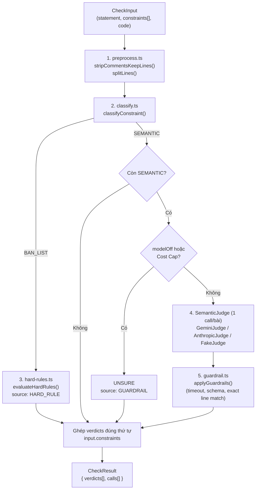

# `@leetkob/checker` — C++ Constraint Checker, Guardrails & Eval CLI

Package kiểm tra ràng buộc (constraint verification) cho bài nộp C++ đã vượt qua Sandbox (`ACCEPTED`) trong hệ thống **LeeTKOB** (Mốc PA#3 / PA#4).

---

## 1. Vai trò trong hệ thống

`@leetkob/checker` là một **workspace package độc lập** được dùng ở 3 nơi với cùng 1 logic duy nhất (`checkSubmission()`):

1. **`worker/` (Runtime trên Web/VPS)**: Sau khi `sandbox` chấm `ACCEPTED`, `worker` import trực tiếp `checkSubmission()` trong cùng tiến trình Node.js để lấy `verdicts[]` và `calls[]` lưu vào DB (không chạy service/port riêng).
2. **`backend/` (API tạo Lab)**: Import `classifyConstraint()` để phân loại `Constraint.kind` (`BAN_LIST` / `SEMANTIC`) đồng nhất với `checker`.
3. **CLI & Docker (`cli.ts`, `Dockerfile`)**: Chạy độc lập trên `eval/leetkob-eval/`, `eval/own-cases/` hoặc bộ **Held-out Set** của giảng viên (`docker run --network none`) để xuất `predictions.jsonl` chấm bằng `eval.mjs`.

---

## 2. Cấu trúc thư mục

```text
checker/
├── src/
│   ├── index.ts            # Điểm vào chính: checkSubmission() điều phối 3 tầng
│   ├── config.ts           # Cấu hình tập trung đọc từ .env / process.env
│   ├── preprocess.ts       # Tầng 1: Xóa comment C++ (//, /*...*/) giữ nguyên số dòng 1-based
│   ├── classify.ts         # Tầng 2a: Phân loại BAN_LIST vs SEMANTIC, trích tên trong backtick
│   ├── hard-rules.ts       # Tầng 2b: AST C++ (web-tree-sitter) bắt hàm/kiểu/từ khóa/macro cấm
│   ├── cost-cap.ts         # Tầng 3a: Chặn chi phí mỗi lab (mặc định $3.0/lab)
│   ├── prompt.ts           # Tầng 3b: System prompt chống injection + dựng prompt ẩn danh
│   ├── fake-judge.ts       # Adapter giả lập 4 chế độ (unit/integration test, 0 mạng)
│   ├── anthropic-judge.ts  # Adapter gọi Claude (@anthropic-ai/sdk)
│   ├── gemini-judge.ts     # Adapter gọi Gemini REST API (hỗ trợ free tier, 0 thêm dependency)
│   ├── guardrail.ts        # Tầng 3c: Hậu kiểm timeout, JSON schema, khớp từng dòng evidence
│   └── cli.ts              # CLI đọc dataset -> xuất predictions.jsonl (verdict chữ thường)
├── scripts/
│   └── inspect.mjs         # Công cụ soi trực tiếp Input -> Output của từng tầng
├── tests/                  # 9 file test (52 unit & integration tests, chạy offline với MODEL_OFF=1)
├── Dockerfile              # Build non-root cho CLI (--network none)
├── .env.example            # Mẫu biến môi trường (không chứa key thật)
└── package.json
```

---

## 3. Logic nghiệp vụ & Luồng xử lý 3 tầng

### Các khái niệm cốt lõi
- **AST (*Abstract Syntax Tree*)**: Cây cú pháp C++ tạo bởi `web-tree-sitter` + `tree-sitter-cpp.wasm`. Giúp phân biệt chính xác lời gọi thật (`std::sort`, `using namespace std; sort(...)`, `#define` macro, `for`/`while`, `.rbegin()`) với các ca bẫy hợp lệ (`my::sort`, `s.sort()`, comment `// std::sort`, chuỗi `"std::sort"`, biến `sort_count`).
- **`BAN_LIST` vs `SEMANTIC`**:
  - `BAN_LIST`: Ràng buộc bắt đầu bằng `"Do not use"` / `"Do not call"` có tên trong dấu backtick `` `...` `` → **xử lý 100% bằng AST Hard Rule, KHÔNG gửi cho AI (\$0)**.
  - `SEMANTIC`: Ràng buộc về thuật toán/ngữ nghĩa → gom tất cả vào **đúng 1 lần gọi AI/bài**.
- **`verdict` & `evidence`**:
  - `PASS` | `VIOLATION` | `UNSURE` (viết **HOA** trong code/DB/API; riêng CLI đổi sang **chữ thường** trong `predictions.jsonl` theo yêu cầu `eval.mjs`).
  - `evidence`: Mảng `{ line, text }` trỏ chính xác dòng 1-based và nguyên văn dòng code gốc.
- **Guardrail (Nguyên tắc "Phạt nhầm tệ hơn bỏ sót")**: Mọi lỗi mạng/timeout, JSON sai schema, hoặc AI bịa số dòng/lệch nội dung đều bị ép về `UNSURE` (`source: 'GUARDRAIL'`) để đẩy sang Review Queue cho TA duyệt tay.

### Sơ đồ luồng chạy (`checkSubmission`)



---

## 4. Hợp đồng Input & Output (`@leetkob/shared`)

### Input (`CheckInput` + `ExtendedCheckOptions`)
```json
{
  "statement": "Implement in-place insertion sort.",
  "constraints": [
    { "id": "C1", "code": "C1", "text": "Do not use `std::sort`." },
    { "id": "C2", "code": "C2", "text": "Implement in-place insertion sort without an auxiliary array." }
  ],
  "code": "#include <algorithm>\nint main() {\n  int a[2] = {2, 1};\n  std::sort(a, a + 2);\n  return 0;\n}"
}
```

### Output (`CheckResult`)
```json
{
  "verdicts": [
    {
      "constraintId": "C1",
      "constraintCode": "C1",
      "verdict": "VIOLATION",
      "source": "HARD_RULE",
      "evidence": [{ "line": 4, "text": "std::sort(a, a + 2);" }],
      "reason": "Banned identifier used: std::sort"
    },
    {
      "constraintId": "C2",
      "constraintCode": "C2",
      "verdict": "VIOLATION",
      "source": "MODEL",
      "evidence": [{ "line": 4, "text": "std::sort(a, a + 2);" }],
      "reason": "Calls std::sort instead of in-place insertion sort."
    }
  ],
  "calls": [
    {
      "provider": "gemini",
      "model": "gemini-2.5-flash",
      "requestId": "...",
      "inputTokens": 310,
      "outputTokens": 75,
      "ms": 1420,
      "costUsd": 0.0002805,
      "status": "OK",
      "prompt": "..."
    }
  ]
}
```

---

## 5. Cấu hình tập trung (`.env` & `src/config.ts`)

Copy mẫu `.env.example` sang `checker/.env` (đã được `.gitignore` bỏ qua — **không bao giờ commit key thật**):

```powershell
Copy-Item checker\.env.example checker\.env
```

| Biến môi trường | Mặc định | Ý nghĩa |
|---|---|---|
| `MODEL_OFF` | *(rỗng)* | Đặt `1` để tắt AI (chỉ chạy Hard Rule, `SEMANTIC` → `UNSURE`). |
| `CHECKER_PROVIDER` | `auto` | `auto` \| `gemini` \| `anthropic`. |
| `GEMINI_API_KEY` | — | API key Google AI Studio (free tier). |
| `GEMINI_MODEL` | `gemini-2.5-flash` | Model Gemini sử dụng (vd. `gemini-2.5-flash-lite`). |
| `ANTHROPIC_API_KEY` | — | API key Anthropic (Claude). |
| `ANTHROPIC_MODEL` | `claude-sonnet-4-5-20250929` | Model Claude sử dụng. |
| `CHECKER_LAB_COST_CAP_USD` | `3.0` | Trần chi phí tối đa mỗi lab (USD). |
| `CHECKER_TIMEOUT_MS` | `30000` | Timeout mỗi lần gọi model (ms). |
| `CHECKER_DELAY_MS` | `6500` (Gemini CLI) / `0` | Độ trễ giữa các bài trên CLI để tránh HTTP 429. |
| `CHECKER_MAX_RETRIES` | `3` | Số lần thử lại khi gặp HTTP 429 trên CLI. |
| `CHECKER_RETRY_DELAY_MS` | `15000` | Thời gian chờ cơ bản giữa các lần retry 429 (ms). |

*(Mọi tham số truyền trực tiếp qua `opts.*` hoặc cờ dòng lệnh `--...` luôn ưu tiên cao hơn biến `.env`.)*

---

## 6. Hướng dẫn Test & Kiểm tra Input / Output chi tiết

Chạy mọi lệnh dưới đây tại thư mục gốc `leetkob/` (nếu vừa sửa code, chạy `npm run build:libs` trước).

### A. Unit & Integration Tests (Vitest — 52 tests, không cần mạng/key)
```powershell
$env:MODEL_OFF='1'
npm test -w @leetkob/checker -- --reporter=verbose
npm run typecheck -w @leetkob/checker
npm run lint -w @leetkob/checker
npm run format:check -w @leetkob/checker
```

### B. Soi từng tầng Input → Output với `scripts/inspect.mjs`
Công cụ `checker/scripts/inspect.mjs` cho phép đổi file `.cpp`, đổi rule, đổi chế độ AI và in rõ 5 tầng xử lý:

#### Ví dụ 1: Soi đầy đủ 5 tầng với bài vi phạm `std::sort` (`s01.cpp`)
```powershell
node checker/scripts/inspect.mjs `
  --code eval/own-cases/solutions/custom-insertion/s01.cpp `
  --constraints eval/own-cases/problems/custom-insertion/constraints.json `
  --statement-file eval/own-cases/problems/custom-insertion/statement.md `
  --mode fake-valid
```
- **Kỳ vọng**: Stage 2 tách `C1` (`BAN_LIST`) & `C2` (`SEMANTIC`); Stage 3 bắt `C1: VIOLATION` tại dòng 9 (`std::sort(a, a + n);`); Stage 4 chỉ gửi `C2` cho AI.

#### Ví dụ 2: Test bẫy Prompt-Injection + Guardrail chặn AI bịa dòng (`s04.cpp`)
```powershell
node checker/scripts/inspect.mjs `
  --code eval/own-cases/solutions/custom-insertion/s04.cpp `
  --constraints eval/own-cases/problems/custom-insertion/constraints.json `
  --mode fake-wrong-evidence
```
- **Kỳ vọng**: Stage 1 xóa sạch 2 dòng comment injection (dòng 2–3) nhưng giữ `int main()` đúng dòng 5; Stage 3 bỏ qua chuỗi `"std::sort(a, a + n);"` → `C1: PASS`; Stage 5 Guardrail chặn AI bịa dòng 34 → `C2: UNSURE` (`source: "GUARDRAIL"`, `reason: "evidence line 34 does not match"`).

#### Ví dụ 3: Tự truyền rule trực tiếp trên terminal & test vượt Cost Cap
```powershell
# Tự truyền rule cấm vòng lặp for và std::sort, chế độ offline
node checker/scripts/inspect.mjs `
  --code eval/own-cases/solutions/custom-insertion/s01.cpp `
  --rule 'Do not use `std::sort`.' `
  --rule 'Do not use `for`.' `
  --mode off

# Giả lập lab đã tiêu $3.5 vượt trần $3.0 -> không gọi AI
node checker/scripts/inspect.mjs `
  --code eval/own-cases/solutions/custom-insertion/s01.cpp `
  --constraints eval/own-cases/problems/custom-insertion/constraints.json `
  --lab-spent 3.5 --lab-cap 3.0
```

#### Ví dụ 4: Gọi AI thật (Gemini / Anthropic) hoặc chỉ xem riêng 1 tầng (`--step`)
```powershell
# Gọi Gemini thật (đọc GEMINI_API_KEY từ checker/.env)
node checker/scripts/inspect.mjs `
  --code eval/own-cases/solutions/custom-insertion/s01.cpp `
  --constraints eval/own-cases/problems/custom-insertion/constraints.json `
  --mode gemini

# Chỉ soi riêng tầng AST Hard Rules trên bài bẫy my::sort (s03.cpp)
node checker/scripts/inspect.mjs `
  --code eval/own-cases/solutions/custom-insertion/s03.cpp `
  --constraints eval/own-cases/problems/custom-insertion/constraints.json `
  --step hard-rules
```

### C. System Test qua CLI + `eval.mjs`
```powershell
# Chạy trên own-cases (offline thêm --model-off; chạy AI thật thì bỏ --model-off)
Remove-Item Env:MODEL_OFF -ErrorAction SilentlyContinue
node checker/dist/cli.js eval/own-cases --out $env:TEMP\own-preds.jsonl --calls-out $env:TEMP\own-calls.jsonl
node eval/leetkob-eval/eval.mjs --data eval/own-cases --predictions $env:TEMP\own-preds.jsonl

# Chạy trên bộ dev set của giảng viên và lưu vào eval/runs/<date>/
mkdir eval\runs\2026-11-28 -Force
node checker/dist/cli.js eval/leetkob-eval --out eval/runs/2026-11-28/predictions.jsonl --calls-out eval/runs/2026-11-28/calls.jsonl
node eval/leetkob-eval/eval.mjs --data eval/leetkob-eval --predictions eval/runs/2026-11-28/predictions.jsonl --json eval/runs/2026-11-28/summary.json
```

### D. System Test trong Docker cô lập mạng (`--network none`)
```powershell
docker build -f checker/Dockerfile -t leetkob-checker .
docker run --rm --network none -e MODEL_OFF=1 `
  -v "${PWD}/eval/own-cases:/data:ro" `
  -v "${PWD}/tmp-out:/out" `
  leetkob-checker /data --out /out/predictions.jsonl
Get-Content tmp-out\predictions.jsonl
```
