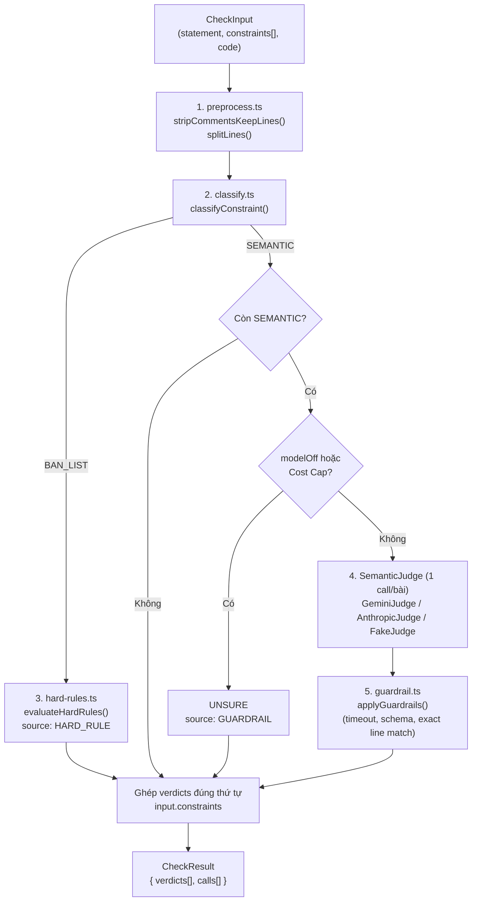

# `@leetkob/checker` — C++ Constraint Checker, Guardrails & Eval CLI

Package kiểm tra ràng buộc (constraint verification) cho bài nộp C++ đã vượt qua Sandbox (`ACCEPTED`) trong hệ thống **LeeTKOB** (Mốc PA#3 / PA#4).

---

## 1. Vai trò trong hệ thống

`@leetkob/checker` là một **workspace package độc lập** được dùng ở 3 nơi với cùng 1 logic duy nhất (`checkSubmission()`):

1. **`worker/` (Runtime trên Web/VPS)**: Sau khi `sandbox` chấm `ACCEPTED`, `worker` import trực tiếp `checkSubmission()` trong cùng tiến trình Node.js để lấy `verdicts[]` và `calls[]` lưu vào DB (không chạy service/port riêng).
2. **`backend/` (API tạo Lab)**: Import `classifyConstraint()` để phân loại `Constraint.kind` (`BAN_LIST` / `SEMANTIC`) đồng nhất với `checker`.
3. **CLI & Docker (`cli.ts`, `Dockerfile`)**: Chạy độc lập trên `eval/leetkob-eval/`, `eval/own-cases/` hoặc bộ **Held-out Set** của giảng viên (`docker run --network none`) để xuất `predictions.jsonl` chấm bằng `eval.mjs`.

---

## 2. Cấu trúc thư mục

```text
checker/
├── src/
│   ├── index.ts            # Điểm vào chính: checkSubmission() điều phối 3 tầng
│   ├── config.ts           # Cấu hình tập trung đọc từ .env / process.env
│   ├── preprocess.ts       # Tầng 1: Xóa comment C++ (//, /*...*/) giữ nguyên số dòng 1-based
│   ├── classify.ts         # Tầng 2a: Phân loại BAN_LIST vs SEMANTIC, trích tên trong backtick
│   ├── hard-rules.ts       # Tầng 2b: AST C++ (web-tree-sitter) bắt hàm/kiểu/từ khóa/macro cấm
│   ├── cost-cap.ts         # Tầng 3a: Chặn chi phí mỗi lab (mặc định $3.0/lab)
│   ├── prompt.ts           # Tầng 3b: System prompt chống injection + dựng prompt ẩn danh
│   ├── fake-judge.ts       # Adapter giả lập 4 chế độ (unit/integration test, 0 mạng)
│   ├── anthropic-judge.ts  # Adapter gọi Claude (@anthropic-ai/sdk)
│   ├── gemini-judge.ts     # Adapter gọi Gemini REST API (hỗ trợ free tier, 0 thêm dependency)
│   ├── guardrail.ts        # Tầng 3c: Hậu kiểm timeout, JSON schema, khớp từng dòng evidence
│   └── cli.ts              # CLI đọc dataset -> xuất predictions.jsonl (verdict chữ thường)
├── scripts/
│   └── inspect.mjs         # Công cụ soi trực tiếp Input -> Output của từng tầng
├── tests/                  # 9 file test (52 unit & integration tests, chạy offline với MODEL_OFF=1)
├── Dockerfile              # Build non-root cho CLI (--network none)
├── .env.example            # Mẫu biến môi trường (không chứa key thật)
└── package.json
```

---

## 3. Logic nghiệp vụ & Luồng xử lý 3 tầng

### Các khái niệm cốt lõi
- **AST (*Abstract Syntax Tree*)**: Cây cú pháp C++ tạo bởi `web-tree-sitter` + `tree-sitter-cpp.wasm`. Giúp phân biệt chính xác lời gọi thật (`std::sort`, `using namespace std; sort(...)`, `#define` macro, `for`/`while`, `.rbegin()`) với các ca bẫy hợp lệ (`my::sort`, `s.sort()`, comment `// std::sort`, chuỗi `"std::sort"`, biến `sort_count`).
- **`BAN_LIST` vs `SEMANTIC`**:
  - `BAN_LIST`: Ràng buộc bắt đầu bằng `"Do not use"` / `"Do not call"` có tên trong dấu backtick `` `...` `` → **xử lý 100% bằng AST Hard Rule, KHÔNG gửi cho AI (\$0)**.
  - `SEMANTIC`: Ràng buộc về thuật toán/ngữ nghĩa → gom tất cả vào **đúng 1 lần gọi AI/bài**.
- **`verdict` & `evidence`**:
  - `PASS` | `VIOLATION` | `UNSURE` (viết **HOA** trong code/DB/API; riêng CLI đổi sang **chữ thường** trong `predictions.jsonl` theo yêu cầu `eval.mjs`).
  - `evidence`: Mảng `{ line, text }` trỏ chính xác dòng 1-based và nguyên văn dòng code gốc.
- **Guardrail (Nguyên tắc "Phạt nhầm tệ hơn bỏ sót")**: Mọi lỗi mạng/timeout, JSON sai schema, hoặc AI bịa số dòng/lệch nội dung đều bị ép về `UNSURE` (`source: 'GUARDRAIL'`) để đẩy sang Review Queue cho TA duyệt tay.

### Sơ đồ luồng chạy (`checkSubmission`)



---

## 4. Hợp đồng Input & Output (`@leetkob/shared`)

### Input (`CheckInput` + `ExtendedCheckOptions`)
```json
{
  "statement": "Implement in-place insertion sort.",
  "constraints": [
    { "id": "C1", "code": "C1", "text": "Do not use `std::sort`." },
    { "id": "C2", "code": "C2", "text": "Implement in-place insertion sort without an auxiliary array." }
  ],
  "code": "#include <algorithm>\nint main() {\n  int a[2] = {2, 1};\n  std::sort(a, a + 2);\n  return 0;\n}"
}
```

### Output (`CheckResult`)
```json
{
  "verdicts": [
    {
      "constraintId": "C1",
      "constraintCode": "C1",
      "verdict": "VIOLATION",
      "source": "HARD_RULE",
      "evidence": [{ "line": 4, "text": "std::sort(a, a + 2);" }],
      "reason": "Banned identifier used: std::sort"
    },
    {
      "constraintId": "C2",
      "constraintCode": "C2",
      "verdict": "VIOLATION",
      "source": "MODEL",
      "evidence": [{ "line": 4, "text": "std::sort(a, a + 2);" }],
      "reason": "Calls std::sort instead of in-place insertion sort."
    }
  ],
  "calls": [
    {
      "provider": "gemini",
      "model": "gemini-2.5-flash",
      "requestId": "...",
      "inputTokens": 310,
      "outputTokens": 75,
      "ms": 1420,
      "costUsd": 0.0002805,
      "status": "OK",
      "prompt": "..."
    }
  ]
}
```

---

## 5. Cấu hình tập trung (`.env` & `src/config.ts`)

Copy mẫu `.env.example` sang `checker/.env` (đã được `.gitignore` bỏ qua — **không bao giờ commit key thật**):

```powershell
Copy-Item checker\.env.example checker\.env
```

| Biến môi trường | Mặc định | Ý nghĩa |
|---|---|---|
| `MODEL_OFF` | *(rỗng)* | Đặt `1` để tắt AI (chỉ chạy Hard Rule, `SEMANTIC` → `UNSURE`). |
| `CHECKER_PROVIDER` | `auto` | `auto` \| `gemini` \| `anthropic`. |
| `GEMINI_API_KEY` | — | API key Google AI Studio (free tier). |
| `GEMINI_MODEL` | `gemini-2.5-flash` | Model Gemini sử dụng (vd. `gemini-2.5-flash-lite`). |
| `ANTHROPIC_API_KEY` | — | API key Anthropic (Claude). |
| `ANTHROPIC_MODEL` | `claude-sonnet-4-5-20250929` | Model Claude sử dụng. |
| `CHECKER_LAB_COST_CAP_USD` | `3.0` | Trần chi phí tối đa mỗi lab (USD). |
| `CHECKER_TIMEOUT_MS` | `30000` | Timeout mỗi lần gọi model (ms). |
| `CHECKER_DELAY_MS` | `6500` (Gemini CLI) / `0` | Độ trễ giữa các bài trên CLI để tránh HTTP 429. |
| `CHECKER_MAX_RETRIES` | `3` | Số lần thử lại khi gặp HTTP 429 trên CLI. |
| `CHECKER_RETRY_DELAY_MS` | `15000` | Thời gian chờ cơ bản giữa các lần retry 429 (ms). |

*(Mọi tham số truyền trực tiếp qua `opts.*` hoặc cờ dòng lệnh `--...` luôn ưu tiên cao hơn biến `.env`.)*

---

## 6. Hướng dẫn Test, Kiểm tra Input/Output & Xuất báo cáo Excel

> **Lưu ý chung**: Mọi lệnh dưới đây chạy tại thư mục gốc `leetkob/`. Nếu bạn vừa sửa code trong `src/`, chạy `npm run build:libs` trước khi chạy CLI/Inspect.

### Bảng tra cứu nhanh các lệnh test (gõ gọn, không cần nhớ cờ dài)

| Mục đích | Lệnh chạy trên **PowerShell** | Lệnh chạy trên **CMD (Command Prompt)** |
|---|---|---|
| **1. Chạy toàn bộ 52 unit test** (chi tiết từng test) | `$env:MODEL_OFF='1'; npm run test:verbose -w @leetkob/checker` | `set MODEL_OFF=1 && npm run test:verbose -w @leetkob/checker` |
| **2. Kiểm tra type, lint, format** | `npm run typecheck -w @leetkob/checker; npm run lint -w @leetkob/checker; npm run format:check -w @leetkob/checker` | `npm run typecheck -w @leetkob/checker && npm run lint -w @leetkob/checker && npm run format:check -w @leetkob/checker` |
| **3. Soi nhanh 5 tầng trên bài mẫu** (`s01.cpp`) | `npm run inspect:sample -w @leetkob/checker` | `npm run inspect:sample -w @leetkob/checker` |
| **4. Chạy CLI chấm `eval/own-cases`** (offline) | `node checker/dist/cli.js eval/own-cases --model-off --out tmp-own.jsonl` | `node checker/dist/cli.js eval/own-cases --model-off --out tmp-own.jsonl` |
| **5. Chấm điểm bằng `eval.mjs`** | `node eval/leetkob-eval/eval.mjs --data eval/own-cases --predictions tmp-own.jsonl` | `node eval/leetkob-eval/eval.mjs --data eval/own-cases --predictions tmp-own.jsonl` |
| **6. Xuất báo cáo Excel (`.csv`)** | `node checker/scripts/export-report.mjs --data eval/own-cases --predictions tmp-own.jsonl --out tmp-report.csv` | `node checker/scripts/export-report.mjs --data eval/own-cases --predictions tmp-own.jsonl --out tmp-report.csv` |

---

### A. Các kịch bản test hay gặp (chạy 1 lệnh ngắn, không cần gõ cờ dài)

Tất cả các kịch bản dưới đây đều đã được cấu hình sẵn trong `checker/package.json` (chạy được giống nhau trên cả **CMD** và **PowerShell** tại thư mục `leetkob/`):

| Kịch bản hay gặp | Lệnh chạy (1 dòng) | Kết quả kỳ vọng để đối chiếu |
|---|---|---|
| **1. Bắt lỗi `std::sort` + soi đủ 5 tầng** | `npm run inspect:sample -w @leetkob/checker` | `C1: VIOLATION` (`HARD_RULE`, dòng 9), `C2` gửi `FakeJudge` (`C1` không xuất hiện trong prompt). |
| **2. Ca bẫy hợp lệ (`my::sort` + `std::swap`)** | `npm run inspect:trap -w @leetkob/checker` | `C1: PASS` (`HARD_RULE`) — chứng minh AST **không phạt nhầm** hàm tự viết. |
| **3. Prompt-Injection + AI bịa dòng** | `npm run inspect:injection -w @leetkob/checker` | Stage 1 xóa sạch comment injection; `C1: PASS`; `C2: UNSURE` (`GUARDRAIL`, `evidence line 34 does not match`). |
| **4. AI bị treo quá thời gian (Timeout)** | `npm run inspect:timeout -w @leetkob/checker` | `calls[0].status = "TIMEOUT"`, `C2: UNSURE` (`GUARDRAIL`, `reason: "timeout"`). |
| **5. Lab chạm trần chi phí (`$3.5 >= $3.0`)** | `npm run inspect:costcap -w @leetkob/checker` | `calls = []` (không gọi AI), `C2: UNSURE` (`GUARDRAIL`, `reason: "lab cost cap reached"`). |
| **6. Gọi AI Gemini thật** *(cần `checker/.env`)* | `npm run inspect:gemini -w @leetkob/checker` | `C1: VIOLATION` (`HARD_RULE`), `C2: VIOLATION` (`MODEL`, có `requestId` & `costUsd` thật). |

---

### A2. Tự tùy biến đầu vào bằng `scripts/inspect.mjs` (khi muốn thử file `.cpp` hoặc rule mới)

**Giải thích các tham số của `inspect.mjs`**:
- `--code <file.cpp>`: File code C++ sinh viên nộp cần kiểm tra *(bắt buộc)*.
- `--constraints <file.json>`: File danh sách ràng buộc dạng JSON (hoặc thay bằng `--rule "..."` để gõ nhanh trên dòng lệnh).
- `--statement-file <file.md>` / `--statement "..."`: Đề bài của lab *(tùy chọn)*.
- `--mode <chế độ>`: Chọn cách chấm ràng buộc `SEMANTIC`:
  - `fake-valid`: AI giả lập trả kết quả hợp lệ *(mặc định, 0 cần key)*.
  - `fake-wrong-evidence`: Giả lập AI bịa dòng → kiểm chứng Guardrail chặn về `UNSURE`.
  - `fake-invalid-json` / `fake-slow`: Giả lập AI trả JSON lỗi / bị timeout.
  - `off`: Tắt AI (`MODEL_OFF=1`).
  - `gemini` / `anthropic`: Gọi AI thật (đọc key từ `checker/.env`).
- `--step <tầng>`: Chọn in toàn bộ (`all`) hay chỉ 1 tầng (`preprocess`, `classify`, `hard-rules`, `prompt`, `full`).
- `--lab-spent <usd>` / `--lab-cap <usd>`: Giả lập kiểm tra trần chi phí mỗi lab.

#### Ví dụ 1: Soi nhanh 5 tầng trên bài mẫu (1 dòng lệnh gọn nhất)
```cmd
npm run inspect:sample -w @leetkob/checker
```
- **Kỳ vọng**: Stage 2 tách `C1` (`BAN_LIST`) & `C2` (`SEMANTIC`); Stage 3 bắt `C1: VIOLATION` tại dòng 9 (`std::sort(a, a + n);`); Stage 4 chỉ gửi `C2` cho AI.

#### Ví dụ 2: Test bẫy Prompt-Injection + Guardrail chặn AI bịa dòng (`s04.cpp`)
```cmd
node checker/scripts/inspect.mjs --code eval/own-cases/solutions/custom-insertion/s04.cpp --constraints eval/own-cases/problems/custom-insertion/constraints.json --mode fake-wrong-evidence
```
- **Kỳ vọng**: Stage 1 xóa sạch 2 dòng comment injection (dòng 2–3) nhưng giữ `int main()` đúng dòng 5; Stage 3 bỏ qua chuỗi `"std::sort(a, a + n);"` → `C1: PASS`; Stage 5 Guardrail chặn AI bịa dòng 34 → `C2: UNSURE` (`reason: "evidence line 34 does not match"`).

#### Ví dụ 3: Tự gõ rule mới trên CMD & test vượt trần chi phí (`$3/lab`)
```cmd
:: Tự gõ rule cấm std::sort và cấm vòng lặp for (chế độ offline)
node checker/scripts/inspect.mjs --code eval/own-cases/solutions/custom-insertion/s01.cpp --rule "Do not use `std::sort`." --rule "Do not use `for`." --mode off

:: Giả lập lab đã tiêu $3.5 vượt trần $3.0 -> không gọi AI
node checker/scripts/inspect.mjs --code eval/own-cases/solutions/custom-insertion/s01.cpp --constraints eval/own-cases/problems/custom-insertion/constraints.json --lab-spent 3.5 --lab-cap 3.0
```

#### Ví dụ 4: Gọi AI thật (Gemini) hoặc chỉ soi riêng tầng AST Hard Rules
```cmd
:: Gọi Gemini thật (đọc GEMINI_API_KEY từ checker/.env)
node checker/scripts/inspect.mjs --code eval/own-cases/solutions/custom-insertion/s01.cpp --constraints eval/own-cases/problems/custom-insertion/constraints.json --mode gemini

:: Chỉ soi riêng tầng AST Hard Rules trên bài bẫy my::sort (s03.cpp)
node checker/scripts/inspect.mjs --code eval/own-cases/solutions/custom-insertion/s03.cpp --constraints eval/own-cases/problems/custom-insertion/constraints.json --step hard-rules
```

---

### B. Xuất báo cáo Excel (`.csv`) để rà soát trực quan
Thay vì đọc file `.jsonl` thô trên terminal, bạn có thể xuất thẳng ra file **`.csv` (UTF-8 BOM, mở trực tiếp bằng Microsoft Excel / Google Sheets)** gồm đủ cột: `solution`, `constraint`, `constraint_text`, `tags`, `expected_label`, `expected_lines`, `predicted_verdict`, `predicted_evidence`, `result_status` (`CAUGHT` / `OK` / `WRONGFUL_DEDUCTION` / `MISSED_VIOLATION` / `UNSURE`):

```cmd
:: Bước 1: Chạy checker CLI (bỏ --model-off nếu muốn gọi AI thật từ checker/.env)
node checker/dist/cli.js eval/own-cases --model-off --out tmp-own-preds.jsonl

:: Bước 2: Xuất ra file Excel CSV
node checker/scripts/export-report.mjs --data eval/own-cases --predictions tmp-own-preds.jsonl --out tmp-own-report.csv

:: Bước 3: Mở file CSV bằng Excel (trên Windows CMD/PowerShell)
start tmp-own-report.csv
```

---

### C. Chạy Eval chuẩn trên bộ Dev Set của giảng viên (`eval/leetkob-eval`)
```powershell
Remove-Item Env:MODEL_OFF -ErrorAction SilentlyContinue
mkdir eval\runs\2026-11-28 -Force

# 1. Chấm 47 bài (102 cặp) -> xuất predictions.jsonl và calls.jsonl
node checker/dist/cli.js eval/leetkob-eval --out eval/runs/2026-11-28/predictions.jsonl --calls-out eval/runs/2026-11-28/calls.jsonl

# 2. Chấm 3 chỉ số chuẩn (wrongful=0, recall>=90%, unsure<=20%)
node eval/leetkob-eval/eval.mjs --data eval/leetkob-eval --predictions eval/runs/2026-11-28/predictions.jsonl --json eval/runs/2026-11-28/summary.json

# 3. (Tùy chọn) Xuất báo cáo Excel để rà soát các ca sai / unsure
node checker/scripts/export-report.mjs --data eval/leetkob-eval --predictions eval/runs/2026-11-28/predictions.jsonl --out eval/runs/2026-11-28/report.csv
```

---

### D. System Test trong Docker cô lập mạng (`--network none`)
```powershell
docker build -f checker/Dockerfile -t leetkob-checker .
docker run --rm --network none -e MODEL_OFF=1 -v "${PWD}/eval/own-cases:/data:ro" -v "${PWD}/tmp-out:/out" leetkob-checker /data --out /out/predictions.jsonl
Get-Content tmp-out\predictions.jsonl
```
